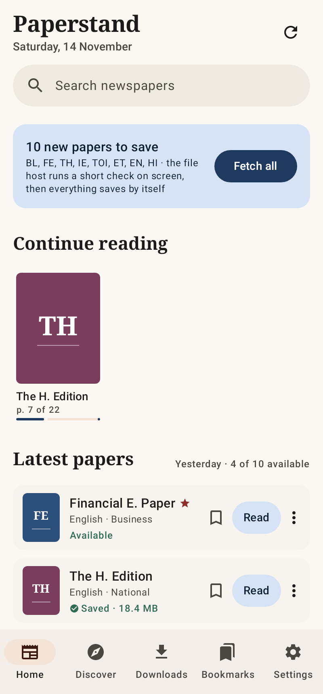
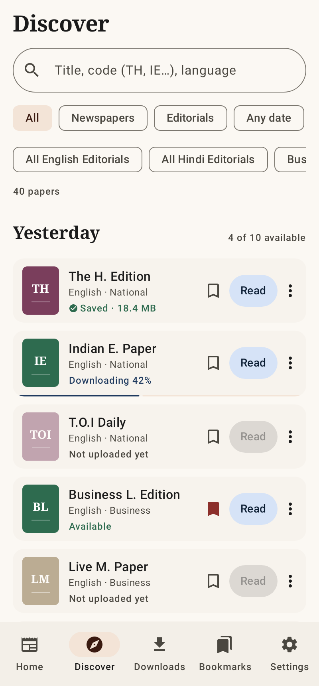
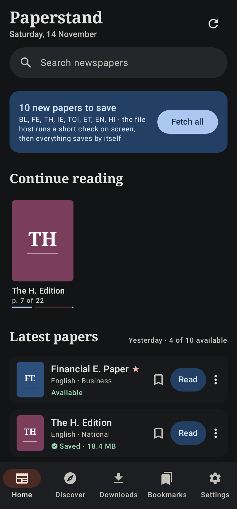
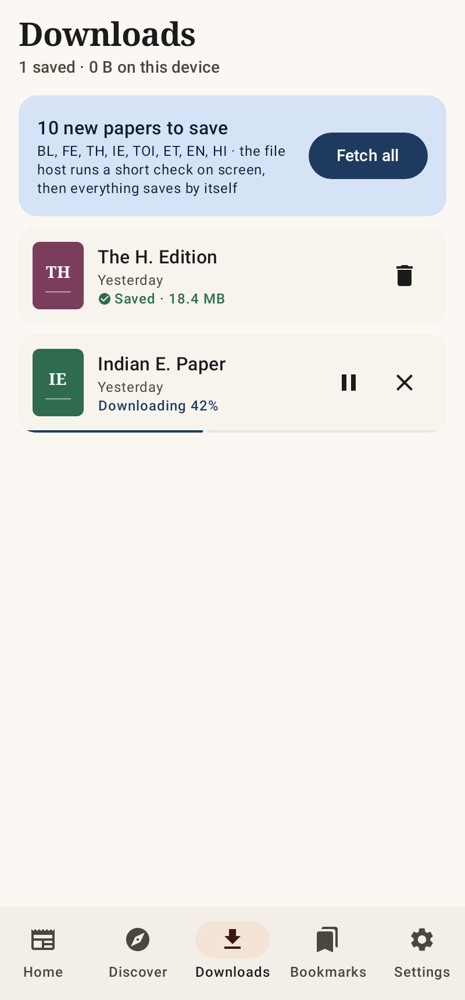
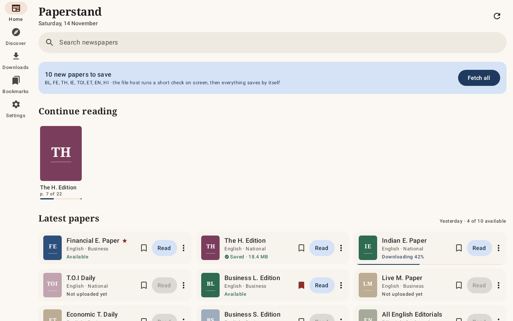

# Paperstand — e-paper reader for epaperwala11.blogspot.com

A native Android app (Kotlin, Jetpack Compose, Material 3) that lists the newspapers published on
[epaperwala11.blogspot.com](https://epaperwala11.blogspot.com/?m=1), resolves each paper's link to the
actual PDF, and opens it in a built-in reader. There are no intermediate pages, ad tabs or browser hops,
and editions you have read stay available offline.

* `docs/WEBSITE_ANALYSIS.md`: how the site and its file hosts work (verified against the live site), with the redirect chain and the limits on automating it
* `docs/ARCHITECTURE.md`: modules, flows, data model, reliability and security decisions
* `apk/paperstand-debug.apk`: debug build, ready to install

<p>
 
 
</p>


*Rendered from the real app by the Robolectric screenshot tests, with fixture data from the live site.*

## What it does

| Area | Features |
|---|---|
| Discovery | Blogger JSON feed with HTML fallback · title, date, category, language · per-paper status (available, not uploaded yet, holiday "Sunday Off", removed from host) · newest first · search · filters by category, date, publication and "readable only" · pull to refresh · background refresh every 3 h |
| Extraction | Google Drive and direct PDFs: fully automatic · DevUploads: sandboxed in-app browser with ads and pop-up tabs blocked, the download button auto-pressed, and the file captured and validated · redirect cap and loop detection · dead-link detection · rules in `core/src/main/resources/extraction_rules.json` |
| Reader | Platform `PdfRenderer` · vertical scroll or page-by-page · pinch zoom and double-tap zoom · fit width / fit page · page slider · thumbnail grid · full screen · brightness · dark (inverted) pages · resumes at the last page · share source link · keep screen on |
| Downloads | Progress · pause / resume (HTTP Range) · cancel · delete · sizes and total storage · no duplicate downloads · `%PDF` + `%%EOF` validation · cover thumbnails |
| Library | Continue reading · recently opened · bookmarks · favourite publications · reading history (Room, on the device only) |
| UI | Bottom navigation on phones, navigation rail on tablets and foldables (≥600 dp) · adaptive card grid · light, dark and Material You themes |

## Automatic downloads

New papers are downloaded **without being asked**: every refresh (on launch, on pull-to-refresh and every 3 h
in the background) queues the two newest editions. You stay in control:

* **Stop** a download (✕ in Downloads) or **delete** a saved paper: auto-download will not fetch it again.
* **Pause / resume** a download in progress (HTTP Range resume).
* **Pause a publication**: ⋮ → *Pause auto-download of …* on any card, or Settings → Auto-download.
* Turn auto-download off entirely in Settings.

### The DevUploads limit, stated plainly

Google Drive and direct-PDF links download fully in the background. DevUploads, where the blog currently
puts every paper, does not allow that. Its guard script (`dl-guard.js`, deliberately obfuscated) requires a
Cloudflare Turnstile / hCaptcha / proof-of-work check, and its countdown **pauses whenever the page is not on
screen**. Solving the captcha or faking page visibility would be defeating an anti-automation control, and the
app does not do that.

So DevUploads papers come through **one tap per day**. When new ones arrive, Home and Downloads show
*"N new papers to save · Fetch all"*. Fetch all walks through every pending paper in the in-app sandbox:

* ads, trackers, pop-up tabs and page dialogs (`alert`/`confirm`) are blocked;
* the download button is pressed for you;
* each file is captured, checked to be a real PDF, and saved;
* the run moves to the next paper on its own (*Skip* and *Stop* are available).

You only keep the screen open, and tap the host's checkbox if it ever shows one.

## Build

Requirements: JDK 17+ (21 tested), Android SDK with platform 35 and build-tools 35.0.0.

```bash
echo "sdk.dir=/path/to/Android/sdk" > local.properties   # or set ANDROID_HOME
./gradlew :app:assembleDebug                              # → app/build/outputs/apk/debug/app-debug.apk
adb install -r app/build/outputs/apk/debug/app-debug.apk
```

Or open the folder in Android Studio (Ladybug or newer) and run the `app` configuration.

## Tests

```bash
./gradlew :core:test                 # parser, resolver (MockWebServer: redirects, loops, fake PDFs, dead links), validator
./gradlew :app:testDebugUnitTest     # Room repository, download worker (resume/validation/retry), browser policy,
                                     # filters, Compose screenshots on phone/tablet/dark → app/build/screenshots/
LIVE=1 ./gradlew :core:test --tests '*LiveSiteTest*'               # real site: discover all editions, resolve links
LIVE=1 ./gradlew :app:testDebugUnitTest --tests '*LiveEndToEnd*'  # real site → Room → resolve → worker download → valid PDF
```

App tests run on the JVM with Robolectric, so they need no emulator.

## Known limitations

* **DevUploads papers need the on-screen "Fetch all" run** (see above). Whether its check passes without a
  tap depends on Cloudflare's view of the device.
* The DevUploads steps *after* the check (countdown, final file URL) could not be observed from the build
  environment, because the check does not load in a headless browser. Capture is therefore generic (WebView
  download events, `.pdf` navigations, HEAD-checked redirects) rather than tuned to an observed final URL.
  It should be confirmed on a real device; if it misses, the page stays visible and "Open in browser" works.
* Links on the blog expire after about 48 hours. Older editions show "Removed from host" once checked.
  Copies you downloaded stay readable.
* `PdfRenderer` renders whole pages, capped at 2600 px wide. Very deep zoom on broadsheet pages gets
  softer; tile-based rendering is on the roadmap.
* The reader UI and real PDF rendering were not exercised on a device or emulator during development (the
  build machine has no KVM). Everything else was tested on the JVM, including against the live site.

## Roadmap

1. Tile-based rendering at high zoom, and text search with a PDF engine (pdfium) if needed.
2. Remote-updatable `extraction_rules.json` (signed), so host changes need no app update.
3. Notification when favourite publications publish a new edition.
4. Auto-delete downloads older than N days, with a storage quota.
5. Instrumented UI tests on a device farm, and Baseline Profiles for startup.

## Content and copyright

The app lists what the blog publishes and keeps the original post one tap away (⋮ → *Open original post*,
the share button in the reader, and Settings → About). Files stay in app-private storage and are never
uploaded or shared. The newspapers belong to their publishers. Many are subscription e-papers, so it is up
to users to make sure that reading them this way is permitted where they live.
